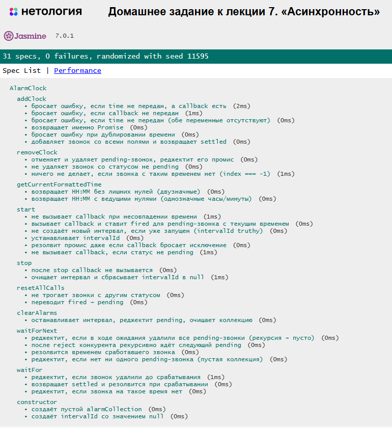

# Домашнее задание к лекции 7 «Асинхронность» 

## Задача 1. Будильник-колыбельная

Помогите Васе перестать просыпать на пары. 
Для этого нужно написать программу-будильник-колыбельную с возможностью добавления, удаления, запусков и остановки звонков.

### Структура класса

| Свойство | Назначение |
|----------|-----------|
| `alarmCollection` | массив звонков |
| `intervalId` | id таймера (или `undefined` / `null`) |

### Структура одного звонка в `alarmCollection`

| Поле | Назначение |
|------|-----------|
| `callback` | функция, которую надо вызвать при срабатывании |
| `time` | строка `'HH:MM'` |
| `status` | **служебное**, `'pending'` \| `'fired'` \| `'cancelled'` — для `waitFor`/`waitForNext` |
| `settled` | **служебное**, `Promise<string>` — «промис звонка» |
| `resolve` | **служебное**, функция, которой резолвим `settled` |
| `reject` | **служебное**, функция, которой реджектим `settled` |

## Что нужно сделать

Необходимо написать класс **AlarmClock** с методами:

1. `constructor` — выделяет память для объекта. 
  * Создайте свойство для хранения коллекции звонков `alarmCollection` с начальным значением пустого массива. 
  * Создайте свойство `intervalId` для хранения `id` таймера без начального значения.

2. `addClock` — добавляет новый звонок в коллекцию существующих. 
  * Принимает параметр времени в формате `HH:MM` — время, когда действие должно запуститься.
  * Принимает параметр функции-коллбека — действие, которое должно запуститься.
  * Проверьте, переданы ли параметры времени и коллбека. Если параметр не передан, выполните выброс ошибки с помощью `throw new Error('Отсутствуют обязательные аргументы')`.
  * Проверьте, есть ли звонок с таким же временем. Если есть, выполните выброс ошибки с помощью `throw new Error('Уже присутствует звонок на это же время')`.
  * Создайте `settled` и **сразу сохраните** его `resolve`/`reject`:
   ```js
   let resolve, reject;
   const settled = new Promise((res, rej) => { resolve = res; reject = rej; });
   settled.catch(() => {}); // заглушка от неперехватываемого исключения
   ```
   Заглушка **не мешает** пользователю `await`-ить `settled` позже — просто гасит консольный warning, если на промис никто не подписался.
  * Добавьте в массив звонков объект со свойствами `callback` / `time` / `status` (со значением *pending*) / `settled`, `resolve`, `reject`.
  * Верните из метода созданный промис `settled`.

3. `removeClock` — удаляет звонок по определённому времени.
  * Принимает `time` звонка, который следует удалить.
  * Найдите звонок с `alarm.time === time` и `alarm.status === 'pending'` — это "живой" ожидающий звоной.
  * Для такого звонка выполните:
   - `alarm.status = 'cancelled'`
   - ``alarm.reject(new Error(\`Звонок на ${alarm.time} удалён до срабатывания\`))`` (без этого `waitFor`/`waitForNext` для такого звонка "зависли" бы навсегда).
   - Если звонок уже `fired`, `reject` — **no-op** (промис уже fulfilled), поэтому проверка `status` не строго обязательна, но защищает от путаницы.
  * Удалите найденый звонок.


4. `getCurrentFormattedTime` — возвращает текущее время в строковом формате `HH:MM`.

5. `start` — запускает будильник.
  * Проверьте наличие значения в свойстве `intervalId`. Если в нём присутствует значение, то завершайте выполнение метода. Программа не должна позволять создавать несколько интервалов.
  * Создавайте новый интервал, в котором каждую секунду выполняйте действия:
     - Получите текущее время с помощью метода `getCurrentFormattedTime`
     - Проверьте, есть ли звонок, который необходимо запустить (в свойстве `time` должно быть текущее время **И** статус `pending`).
     - Если оба условия истинны:
      - Установите `alarm.status = 'fired'`.
      - Вызовите `alarm.resolve(alarm.time)` — **до** вызова коллбека. Это соответствует требованию "промис резолвится в момент вызова `callback`", и защищает от ситуации, когда `callback` бросает исключение.
      - Вызовите `alarm.callback()`.

6. `stop` — останавливает выполнение интервала будильника.
  * Вызовите функцию `clearInterval` для удаления интервала.
  * Сбросьте значение из свойства `intervalId`. Для сброса свойства можно присваивать `null`.

7. `resetAllCalls` — сбрасывает возможность запуска всех звонков.
  * С помощью `forEach` переберите все объекты звонков. Для каждого звонка, у которого `status === 'fired'`, установите `status = 'pending'`.
  * *Промисы сработавших звонков остаются `fulfilled` — после `resetAllCalls` снова срабатывает только `callback`, но `settled` уже не изменится.*

8. `clearAlarms` — удаляет все звонки.
  * Вызывите метод остановки интервала (метод `stop`).
  *  С помощью `forEach` переберите все объекты звонков. Eсли `status === 'pending'`, вызовите ``alarm.reject(new Error(\`Звонок на ${alarm.time} удалён до срабатывания\`))``; 
  * Удалите все звонки. Для удаления всех звонков переприсваивайте свойство `alarmCollection` в пустой массив.

9. `waitFor` - ждёт срабатывания конкретного звонка.
  * Принимает time в формате `HH:MM`.
  * Найдите звонок, у которого в `time` находится переданное время.
  * Если звонка нет — верните ``Promise.reject(new Error(\`Нет звонка на ${time}\`))``.
  * Если звонок был найден - верните `alarm.settled`.

10. `waitForNext` - ждёт срабатывания ближайшего звонка из коллекции.
  * Отфильтруйте из `alarmCollection` звонки со `status === 'pending'` — это «активные» кандидаты.
  * Если таких звонков нет — верните `Promise.reject(new Error('Нет активных звонков'))`.
  * Постройте `Promise.race` по массиву «обёрток»: для каждого `pending`-звонка возьмите
   ```
   alarm.settled.then(
     time => ({ fired: true,  time }),
     ()   => ({ fired: false })
   )
   ```
  **Ключевой трюк:** второй аргумент `.then` (`onRejected`) превращает **любой** reject в **успешное** значение `{ fired: false }`. Благодаря этому:
   - удаление одного конкурента не «уронит» весь `race`;
   - `race` сработает либо по факту срабатывания звонка, либо по факту удаления какого-то из конкурентов.
  * Допишите к `race` `.then(result => { ... })`:
   - если `result.fired === true` → верните `result.time`;
   - если `result.fired === false` (кого-то удалили) → **рекурсивно** вызовите `this.waitForNext()` — пересчитает актуальный список `pending` и снова начнёт ждать. Если после удаления не осталось ни одного `pending`, рекурсивный вызов сразу вернёт `Promise.reject('Нет активных звонков')`, как и требует спецификация.

### Ключевая идея промис-API

При создании звонка (`addClock`) мы сразу заводим `Promise` и сохраняем его `resolve`/`reject` внутри объекта звонка:
- **Резолвим** его внутри `start` — в момент, когда звонок сработал.
- **Реджектим** его в `removeClock` / `clearAlarms` — если звонок удалили раньше.

Тогда:
- `waitFor(time)` = найти звонок и вернуть его `settled`.
- `waitForNext()` = `Promise.race` по обёрткам над `settled`, которые переживают отмену.

Создавать `settled` сразу, а не лениво, выгодно: если звонок сработал *до* вызова `waitFor`, промис уже `fulfilled`, и `waitFor` мгновенно его вернёт — никаких пропущенных событий.

Дополнительно вешаем на `settled` пустой `.catch(() => {})` — иначе, если пользователь не подпишется, а звонок удалят, Node/browser напечатает «unhandled rejection». Пустой catch **не мешает** пользователю потом сделать `await alarm.settled` и получить reject — он только подавляет консольный warning.

## Результат при правильном решении задания


## Требования к выполнению домашней работы

1. Все тесты успешно выполняются.
2. Соблюдается [кодстайл](https://github.com/netology-code/codestyle/tree/master/js#%D0%BF%D1%80%D0%B0%D0%B2%D0%B8%D0%BB%D0%B0-%D0%BE%D1%84%D0%BE%D1%80%D0%BC%D0%BB%D0%B5%D0%BD%D0%B8%D1%8F-javascript-%D0%BA%D0%BE%D0%B4%D0%B0).
3. Решение загружено в форкнутый репозиторий GitHub.
4. Решение опубликовано в GitHub Pages.

## Решение задач
1. Откройте файл `task.js` в вашем редакторе кода и выполните задание. <br>
2. Проверьте соблюдение [кодстайла](https://github.com/netology-code/codestyle/tree/master/js#%D0%BF%D1%80%D0%B0%D0%B2%D0%B8%D0%BB%D0%B0-%D0%BE%D1%84%D0%BE%D1%80%D0%BC%D0%BB%D0%B5%D0%BD%D0%B8%D1%8F-javascript-%D0%BA%D0%BE%D0%B4%D0%B0). Форматируйте ваш код через форматтер https://codebeautify.org/jsviewer.
3. Добавьте файл `task.js` в индекс `git` с помощью команды `git add %file-path%`, где `%file-path%` — путь до целевого файла `git add ./7.async/task.js`. <br>
4. Сделайте коммит, используя команду `git commit -m '%comment%'`, где `%comment%` — это произвольный комментарий к вашему коммиту `git commit -m 'Седьмое задание полностью готово'`. <br>
5. Опубликуйте код в репозиторий `homeworks` с помощью команды `git push -u origin main`.<br>
6. На проверку пришлите 2 ссылки. На файл с решением (`task.js`) и на страницу GitHub Pages — страницу с автотестами: `https://%USERNAME%.github.io/bjs-2-homeworks/7.async`.

**_Никакие файлы прикреплять не нужно._**